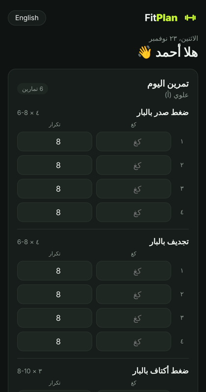

# FitPlan 🏋️

**[English](#english) | [العربية](#العربية)**

A bilingual (Arabic / English) web app that builds your gym schedule, tracks your lifts, and organizes your meals around your daily calorie and macro targets.

<p align="center">
  
  
  
</p>

---

## English

### Features
- **Personal targets.** Calculates BMR, TDEE, daily calories, protein, carbs and fat from your profile and goal (cut, maintain, bulk) using the Mifflin-St Jeor equation, with safe calorie floors.
- **Auto-generated workout plan.** Pick your training days (2 to 6) and get a split that fits: Full Body, Upper/Lower, Upper/Lower + PPL, or Push/Pull/Legs. You can add or remove exercises afterwards.
- **Today screen.** Shows today's workout or a rest day, with your sets from last time.
- **Progressive overload suggestions.** Uses double progression: if you hit the top of the rep range on every working set, it suggests adding 2.5 kg next time.
- **Progress chart.** Estimated 1RM over time per exercise (Epley formula).
- **Meal tracking.** A built-in food database with common Arabic and Gulf foods (kabsa, foul, labneh, dates, hummus…), meal logging by day, remaining calories and macros, and private custom foods.
- **Bilingual UI.** Full Arabic (RTL) and English (LTR), switchable at any time. Works on mobile and can be installed as a PWA.

### Tech stack
| Layer | Tools |
|---|---|
| Backend | Python 3.12, FastAPI, SQLModel (SQLAlchemy + Pydantic) |
| Database | SQLite by default, any SQLAlchemy URL via `DATABASE_URL` |
| Auth | JWT (PyJWT) + bcrypt password hashing |
| Frontend | Vanilla JavaScript, HTML, CSS (no build step) |
| Quality | pytest (33 tests), ruff, GitHub Actions CI |
| Deploy | Docker, Docker Compose |

### Run locally
```bash
python -m venv .venv
source .venv/bin/activate        # Windows: .venv\Scripts\activate
pip install -r requirements-dev.txt
fastapi dev app/main.py
```
Open http://localhost:8000. The interactive API docs are at http://localhost:8000/docs.

**With Docker:**
```bash
SECRET_KEY=your-long-random-secret docker compose up --build
```

### Tests
```bash
pytest -q
ruff check . && ruff format --check .
```

### Project structure
```
app/
  main.py              # app setup, routers, static files
  config.py            # settings from environment variables
  database.py          # engine and session
  models.py            # database tables
  schemas.py           # request/response validation
  security.py          # password hashing, JWT
  deps.py              # auth dependency (current user)
  seed.py              # built-in foods
  routers/             # auth, profile, workouts, meals
  services/
    nutrition.py       # BMR / TDEE / macro calculations
    workouts.py        # exercise library, split templates, progression
  static/              # frontend
tests/
```

### API overview
| Method | Endpoint | Description |
|---|---|---|
| POST | `/api/auth/register` | Create an account |
| POST | `/api/auth/login` | Get an access token |
| GET / PUT | `/api/profile` | Read or update your profile and targets |
| POST | `/api/workouts/plan` | Generate a plan from training days |
| GET | `/api/workouts/plan` | Active plan |
| GET | `/api/workouts/today?day=` | Today's workout with suggestions |
| POST | `/api/workouts/plan/days/{id}/exercises` | Add an exercise to a day |
| PATCH / DELETE | `/api/workouts/plan/exercises/{id}` | Edit or remove an exercise |
| POST / GET | `/api/workouts/logs` | Log a workout, list history |
| GET | `/api/workouts/progress/{exercise}` | Estimated 1RM over time |
| GET / POST | `/api/foods` | Search foods, add a custom food |
| POST | `/api/meals` | Log food |
| GET | `/api/meals?day=` | A day's meals, totals and remaining macros |
| DELETE | `/api/meals/{id}` | Remove a logged food |

### Design decisions
- **Users can only see their own data.** Every query is scoped to the current user, and requests for another user's resources return `404` instead of `403`, so they don't reveal that the resource exists.
- **Login errors don't reveal which accounts exist.** A wrong email and a wrong password return the same message.
- **Dates come from the client.** "Today" depends on the user's time zone, so the frontend sends its local date.
- **Old plans are kept, not deleted.** Generating a new plan deactivates the previous one, so workout history stays linked.
- **Food values are stored per 100 g.** Any amount can then be calculated the same way.

### Roadmap
- [ ] Alembic migrations and PostgreSQL in production
- [ ] Weekly meal plan generator based on targets
- [ ] Body weight tracking with charts
- [ ] Rest timer between sets
- [ ] Refresh tokens

> Nutrition values are approximate and targets are estimates, not medical advice.

---

<div dir="rtl">

## العربية

تطبيق ويب بالعربي والإنجليزي يسوي لك جدول تمارين الجيم، ويتابع الأوزان اللي ترفعها، وينظم أكلك حسب السعرات والبروتين اللي تحتاجها يوميًا.

### المميزات
- **احتياجك اليومي:** يحسب الحرق الأساسي والحرق اليومي، والسعرات والبروتين والكارب والدهون، حسب بياناتك وهدفك (تنشيف أو ثبات أو تضخيم). الحساب بمعادلة Mifflin-St Jeor، مع حد أدنى آمن للسعرات.
- **جدول تمارين تلقائي:** تختار أيام تمرينك (من ٢ إلى ٦ أيام)، ويطلع لك الجدول المناسب: جسم كامل، أو علوي/سفلي، أو دفع/سحب/أرجل. وتقدر تضيف تمارين أو تحذفها.
- **شاشة اليوم:** توريك تمرين اليوم أو إنه يوم راحة، مع أرقامك من آخر مرة.
- **اقتراح زيادة الوزن:** إذا وصلت لأعلى عدد تكرارات في كل المجموعات، يقترح عليك تزيد ٢٫٥ كغ في التمرين الجاي.
- **رسم بياني للتقدم:** يوضح تطور أقصى وزن متوقع (1RM) لكل تمرين.
- **تنظيم الأكل:** قاعدة أطعمة فيها أكلات عربية وخليجية (كبسة، فول، لبنة، تمر، حمص…)، وتسجيل الوجبات لكل يوم، ويوريك كم باقي لك. وتقدر تضيف أكلاتك الخاصة.
- **واجهة بلغتين:** عربي (من اليمين لليسار) وإنجليزي، وتبدّل بينهم بضغطة. تشتغل على الجوال وتقدر تثبّتها كتطبيق (PWA).

### التشغيل
```bash
python -m venv .venv
source .venv/bin/activate        # ويندوز: .venv\Scripts\activate
pip install -r requirements-dev.txt
fastapi dev app/main.py
```
افتح http://localhost:8000، وتوثيق الـ API موجود على http://localhost:8000/docs.

### الاختبارات
```bash
pytest -q
```

> القيم الغذائية تقريبية، والأرقام تقديرية وما تغني عن استشارة مختص.

</div>

---

Built with the help of AI coding tools. / تم تطويره بمساعدة أدوات الذكاء الاصطناعي.
